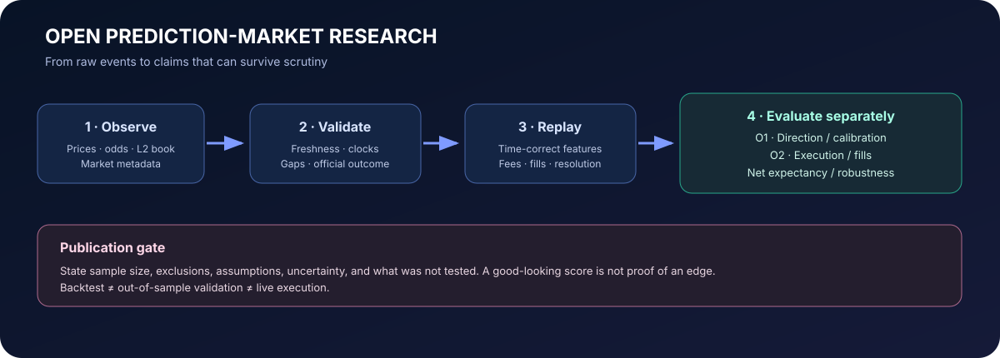
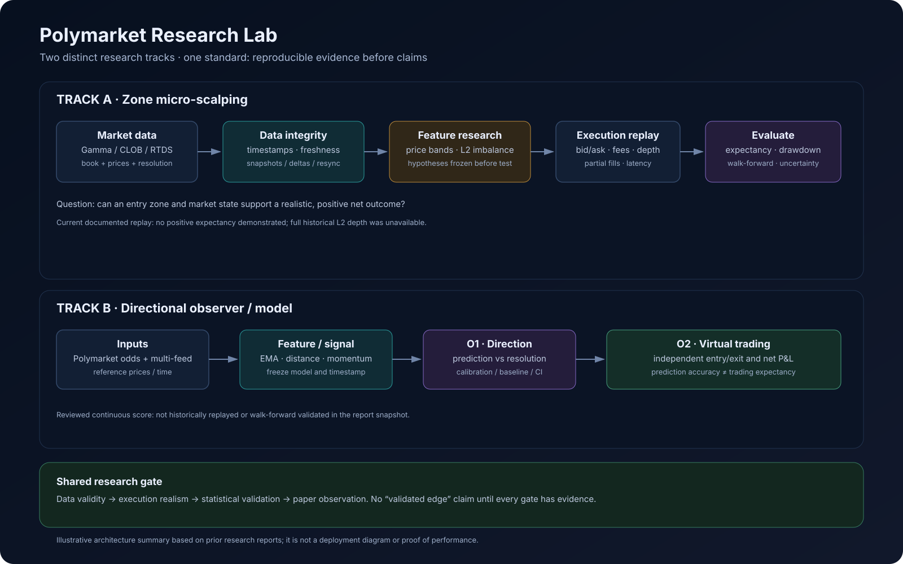

# Polymarket Research Lab

**Un carnet public de recherche sur la construction et l'évaluation honnête d'un bot de micro-scalping par zones sur les marchés BTC 5 minutes de Polymarket.**

> **État :** recherche exploratoire. Aucun avantage rentable, robuste, reproductible et confirmé hors échantillon n'a été démontré. Ce dépôt n'est ni un produit de trading, ni un service de signaux, ni un conseil financier.

## L'histoire : un passionné, une hypothèse et un rêve de 1 000 $

J'aime les marchés prédictifs. J'ai commencé par trader manuellement sur mon propre compte Polymarket. Cette expérience m'a donné envie de comprendre ce qui se passe derrière un simple marché BTC UP/DOWN de cinq minutes : prix d'entrée, spread bid/ask, liquidité disponible, carnet d'ordres, frais, timing et chemin du prix avant la résolution.

Cette curiosité est devenue un projet de recherche. J'ai commencé à collecter des données, à classer les prix d'entrée par zones, à rejouer des marchés historiques, à étudier le carnet d'ordres et à construire un observateur multi-sources. J'ai aussi appris, parfois à mes dépens, qu'un backtest peut raconter une histoire trompeuse.

**Mon rêve personnel est de construire un bot qui pourrait un jour faire progresser mon capital de trading vers un solde de 1 000 $, et de pouvoir me réveiller en constatant que le système a contribué à atteindre ce solde.** C'est un rêve, pas une prévision. Je ne prétends pas l'avoir réalisé, je ne garantis aucun rendement, je ne donne pas de délai et je ne prétends pas pouvoir gagner 1 000 $ par jour. Je ne sais pas encore si cet objectif est réalisable avec cette stratégie.

Je partage les recherches parce que les erreurs, les incertitudes, les données et même les résultats négatifs peuvent aider quelqu'un. Je cherche des retours de personnes qui connaissent les marchés prédictifs, la microstructure, l'exécution, les statistiques et la recherche quantitative.

### L'objectif, dit sans détour — c'est l'ambition visée, pas une affirmation qu'elle est atteinte

| Win rate | Gagnants | Perdants | Profit net par jour (1 520 trades, mise 1 $, +0,9601 $/−1,0567 $) |
|---|---:|---:|---:|
| 100 % | 1 520 | 0 | +1 459,35 $ |
| 90 % | 1 368 | 152 | +1 152,70 $ |
| 80 % | 1 216 | 304 | +846,05 $ |
| 70 % | 1 064 | 456 | +539,40 $ |
| 65 % | 988 | 532 | +386,35 $ |
| 60 % | 912 | 608 | +233,30 $ |
| 55 % | 836 | 684 | +79,80 $ |
| **52,4 %** | **796** | **724** | **≈ 0 $ — seuil de rentabilité** |
| 50 % | 760 | 760 | −73,50 $ |

Capital de départ : 4,77 $. Cible : 1 000 $. Le même dollar réengagé, jamais capitalisé. Ce tableau est de l'arithmétique, pas une prévision — voir [Ce que disent les résultats actuels](#ce-que-disent-les-résultats-actuels) pour ce qui est réellement mesuré face à cette ambition.

Les chiffres +0,9601 $ et −1,0567 $ ci-dessus sont des **moyennes mesurées** sur de nombreux trades dans les données de l'auteur, distinctes de l'**exemple à un seul prix d'entrée, +0,95 $ / −1,056 $**, détaillé dans [la note de comptabilité du TP](docs/take-profit-accounting-fr.md) — c'est pourquoi le seuil de 52,4 % de ce tableau et le seuil de 52,64 % de cette note sont deux nombres différents, non interchangeables, pas une coquille.

## La stratégie que je cherche à tester

La piste principale est le **micro-scalping par zones de prix sur les marchés Polymarket BTC Up/Down de cinq minutes**. Le bot n'est pas validé pour du trading réel sans surveillance ; la stratégie reste une hypothèse.

La question de recherche :

1. Découper les prix d'entrée en bandes définies à l'avance. Une première grille utilisait des zones fines de **0,01 à 0,50**, par incréments de **0,025** ; d'autres rapports étudient des bandes larges ou chevauchantes comme F40 (0,40–0,45) et F45 (0,45–0,50).
2. Observer le prix et, lorsque les données sont disponibles, l'état du carnet autour de la zone d'entrée. Tester si la zone seule ou combinée à l'imbalance du carnet apporte de l'information sur le mouvement futur.
3. Mesurer si une entrée atteint un **objectif de profit net après les frais d'achat et de vente** avant la résolution, puis comparer à une conservation jusqu'à la résolution.
4. Inclure les échecs, les frais, les résultats indéterminés et les limites d'exécution. La zone au meilleur taux de touchée n'est pas automatiquement la meilleure stratégie.
5. Séparer la collecte de données, le rejeu historique, le paper trading/les trades virtuels et toute observation en argent réel.

Le rejeu historique principal résumé ici utilisait une cible de **+0,95 USDC net par mise de 1 $**. Un prototype visuel distinct dans [`prototypes/`](prototypes/) affiche +0,96 $ ; il repose sur un parcours de prix synthétique et ne constitue pas une preuve. Ces deux expériences ne doivent pas être confondues.

### Ce que signifie exactement « +0,95 net »

Pour une mise de 1,00 USDC achetée à 0,20 avec la formule de frais de l'exemple, on achète 5 parts et les frais d'entrée sont de 0,0560 USDC. La sortie initiale de trésorerie est donc de **1,0560 USDC**. Pour terminer avec un **P&L net de +0,9500 USDC**, la vente doit créditer **2,0060 USDC après déduction des frais de sortie** : `2,0060 − 1,0000 de mise − 0,0560 de frais d'entrée = +0,9500`. Les frais ne sont pas remboursés littéralement dans un paiement séparé ; les recettes nettes de vente doivent les couvrir économiquement.

Si la position est réglée à zéro, la perte totale selon ces hypothèses est de −1,0560 USDC. Avec seulement deux issues possibles — exactement +0,95 pour chaque gagnant et exactement −1,056 pour chaque perdant — le seuil théorique de rentabilité est de **52,64 %**. Ce seuil ne s'applique **pas automatiquement** au rejeu « prendre le TP s'il est atteint, sinon conserver jusqu'à la résolution », car un trade qui manque le TP peut quand même recevoir un paiement au règlement. Le taux de touchée n'est pas le taux de réussite. Voir [l'explication complète des flux](docs/take-profit-accounting-fr.md), [la version anglaise](docs/take-profit-accounting.md) et [le calculateur arithmétique](tools/tp_accounting_example.py).

## Ce que j'ai fait jusqu'ici

- Développé le concept d'un observateur/collecteur pour les marchés UP/DOWN courts de BTC/ETH/SOL/XRP et plusieurs flux de prix de référence.
- Développé une piste distincte de recherche sur les zones BTC 5 minutes, l'état du carnet, les entrées/sorties, les frais et la réconciliation du P&L.
- Étudié les snapshots et deltas du carnet CLOB, sa reconstruction locale, les reconnexions, les données périmées, les carnets croisés, les horodatages et la résolution des marchés.
- Rejoué un jeu de données historique public pour tester le taux de touchée et l'espérance nette selon des hypothèses déclarées.
- Séparé **O1** (prédire la direction finale UP/DOWN) de **O2** (savoir si une séquence d'entrée/sortie aurait un P&L net positif). Prédire la bonne direction ne prouve pas qu'un trade est rentable.
- Documenté des problèmes concrets : une commande acceptée n'est pas nécessairement exécutée ; une WebSocket connectée peut rester périmée ; un gros historique de transactions ne remplace pas un historique L2 complet ; des réentrées répétées après un stop peuvent amplifier les pertes.

Voir [la carte des projets](docs/project-map.md), [l'architecture](docs/architecture.md) et [le journal d'avancement](docs/research-status.md).

## Ce que disent les résultats actuels

### Rejeu historique de la cible (résultats rapportés par l'auteur, non reproduits indépendamment ici)

Un rapport rejoue **15 682 marchés** de cinq minutes, **324 048 entrées simulées**, dont **295 921 avec résultat connu**, avec le jeu de données [`kachoio/polymarket-5-minute-crypto-up-down-markets`](https://github.com/kachoio/polymarket-5-minute-crypto-up-down-markets). La simulation utilisait une mise de 1 $, le meilleur ask comme proxy d'entrée, un taux de frais supposé de 0,07, aucun stop loss, une coupure à 120 secondes et le premier contact par marché/zone/côté.

- Meilleure bande rapportée pour toucher la cible **+0,95 $ net** : **F45 (0,45–0,50), 11 297 / 24 210 = 46,7 %**.
- Espérance moyenne F45 rapportée : **−0,0719 $** par mise de 1 $ avec « sortir à la cible si atteinte, sinon garder jusqu'à la résolution » ; **−0,0588 $** en gardant toujours jusqu'à la résolution.
- Le rapport d'espérance associé indiquait une espérance non positive pour les 20 zones testées, avec les deux règles de sortie.
- La source ne fournissait pas un historique L2 complet et horodaté : la file d'attente, les exécutions partielles, la consommation du carnet et les coûts exécutables ne sont donc pas fidèlement simulés.

Les tableaux synthétiques sont disponibles en CSV dans [`data/`](data/). Le code du rejeu et les données brutes ne sont pas fournis ici : ces chiffres sont retranscrits des rapports de recherche de l'auteur et **ne sont pas reproduits indépendamment par ce dépôt**. Certaines bandes se chevauchent et ne sont pas des échantillons indépendants.

### Des campagnes de collecte distinctes

Une première campagne de rapport indiquait environ **10,83 heures**, 663 candidats et 621 entrées conservées après exclusion de 42 observations au carnet croisé. La meilleure zone annoncée était F40 avec **12/22 (54,5 %)**, échantillon bien trop petit pour établir un résultat fiable.

Un autre rapport, sur environ **20,92 heures**, utilisait 5 149 entrées distinctes et 7 098 lignes de zones. Il recensait 4 964 résultats décidés et 2 204 gagnants selon sa propre définition. Ce sont des données et un dénominateur différents du rejeu historique ; il ne faut pas fusionner ces pourcentages.

### Piste exploratoire sur le carnet — pas un résultat validé

Des notes de travail plus récentes ont décrit environ 1,7 million de snapshots L2 et une combinaison exploratoire entre la zone F400 (0,40–0,425) et une imbalance supérieure à 0,7942. Le taux rapporté était autour de 58,9 %, contre environ 49,5 % pour une condition statique. Le présent dépôt ne contient pas encore l'export exact, le dénominateur, la définition du résultat, les exclusions, la séparation temporelle ni le calcul reproductible. Cette piste doit être considérée comme **non vérifiée**, potentiellement affectée par la sélection des paramètres ou le surapprentissage — pas comme un taux de réussite validé ni la preuve d'une rentabilité.

## Architecture générale

Deux pistes liées, mais séparées :

- **Micro-scalping par zones :** collecte des données/carnets → validation des états et horodatages → zones et variables candidates → simulation d'exécution avec coûts → mesure de l'espérance et de la robustesse.
- **Observateur/prédicteur directionnel :** collecte des cotes Polymarket et de plusieurs prix de référence → signaux → évaluation de la direction finale (**O1**) et d'une trajectoire de trading virtuel distincte (**O2**).

Leurs résultats ne doivent pas être mélangés. Le score directionnel continu de la version examinée n'avait pas été rejoué historiquement ni validé en walk-forward dans le rapport examiné. Les petites sessions d'observation ne prouvent pas d'avantage.

## Ce qui reste à faire

- Reproduire le rejeu à partir d'une version figée du jeu de données, avec sommes de contrôle, filtres exacts, code et instructions.
- Rejouer avec un historique L2 et des hypothèses plus réalistes sur le bid/ask, la profondeur, les frais, la latence et les exécutions partielles.
- Fixer l'hypothèse zone/imbalance avant le test, puis utiliser des splits chronologiques et une validation walk-forward.
- Auditer le résultat F400 + imbalance avec son dénominateur, les labels, l'incertitude, la sélection des paramètres et un holdout indépendant.
- Mesurer l'espérance, le drawdown et la robustesse, pas seulement le taux de réussite ou de touchée.
- Garder l'observation virtuelle séparée de tout bot en argent réel. Aucun avantage en trading automatisé réel n'est établi.

## Comment la communauté peut aider

Je cherche surtout des retours sur la simulation L2 et les hypothèses d'exécution, la définition de l'imbalance du carnet, la prévention de la fuite de données et du surapprentissage, la validation walk-forward, le calcul des frais et la reproductibilité des tableaux. Merci de challenger les méthodes et les dénominateurs, pas seulement le pourcentage affiché. Les questions précises sont réunies dans [community-questions.md](docs/community-questions.md).

## Ce qui reste volontairement privé

Ce dépôt est un carnet de recherche, pas un miroir des dépôts privés des bots. Il n'inclut pas de clés, identifiants API, fichiers `.env`, exécutables, archives binaires, journaux complets de compte ni l'ensemble du code privé. Je publie des méthodes, une architecture, des résultats sélectionnés, les leçons et les incertitudes — pas les secrets des systèmes. Voir [SECURITY.md](SECURITY.md).

## Avertissement

Recherche éducative uniquement, pas un conseil financier. Une position Polymarket peut perdre toute la mise. Les résultats historiques et démonstrations synthétiques ne préjugent pas des résultats futurs. Aucune rentabilité n'est revendiquée.

## Par où commencer ?

- [État de la recherche et journal d'avancement](docs/research-status.md)
- [Stratégie, objectif et limites](docs/strategy-and-objective.md)
- [Comptabilité détaillée du TP +0,95 net](docs/take-profit-accounting-fr.md)
- [Exemple de calcul exécutable](tools/tp_accounting_example.py)
- [Architecture](docs/architecture.md)
- [Jeux de données et registre d'expériences](docs/data-status-and-datasets.md)
- [Protocole de recherche](docs/research-protocol.md)
- [Résumés CSV et limites](data/README.md)
- [Avertissement sur le prototype visuel](prototypes/README.md)
- [English README](README.md)
